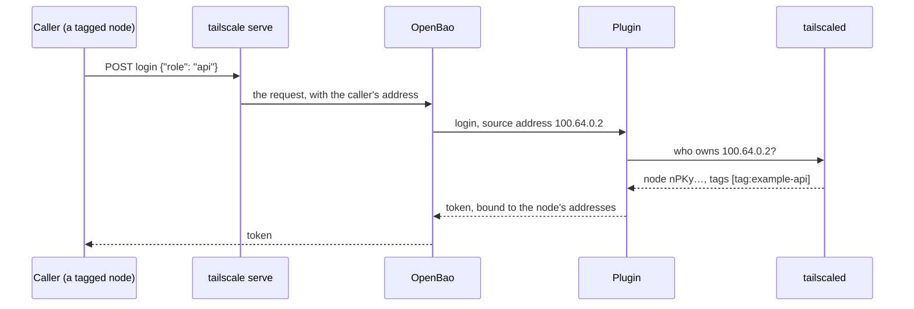

# How a login works

A caller logs in by sending a role name. It proves who it is by where the request comes from: Tailscale
authenticates every packet with the sender's node key, so a tailnet address can't be used by another node.
The plugin turns that address into a node, and the node's tags into a token.

## The checks, in order

1. **The address.** The source address must be a bare address inside Tailscale's ranges, `100.64.0.0/10` or
   `fd7a:115c:a1e0::/48`. Anything else is refused without asking `tailscaled`.
2. **The node.** The plugin asks the local `tailscaled` who owns the address, and which node it runs as itself.
   It waits no longer than the configured timeout for both. No answer is a refusal.
3. **What kind of node.** The node must have tags, must belong to this tailnet, must have a key that hasn't expired, and
   must own the address the request came from. It must not route for other addresses, by what the control server says or
   by what the node advertises: traffic a subnet router or exit node forwards arrives from the router's address, so its
   clients would log in as the router. `tailscaled` must list the address as one the node may send from. Hosting a
   Tailscale Service is fine. The node must not be the one `tailscaled` runs as: every local process on the OpenBao host
   sends from that node's address.
4. **The role.** The role must exist, and the node must carry every tag it binds.

The plugin asks `tailscaled` before it looks up the role, so a refusal takes as long for a role that exists as
for one that doesn't.

## The token

The token is bound to every address of the node, the IPv4 one and the IPv6 one: a caller may reach OpenBao over
either from one request to the next. Its lifetime comes from the role, shortened if the node's key expires
sooner.

## Renewal

A tailnet address can pass to another node, and a tag or a role can change, while a token lives. So a renewal
runs all four checks again, and also requires the node at the address to have the stable ID of the node that
logged in. A token keeps the policies it was issued with, so a renewal is refused when the role's policies have
changed since.

## Nothing is remembered

Every login and every renewal asks `tailscaled` again. The plugin stores its configuration and its roles, and
nothing about nodes.
